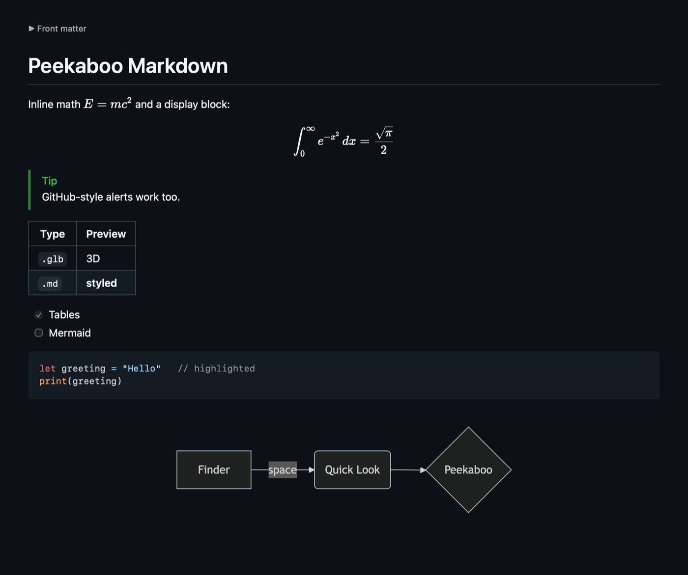
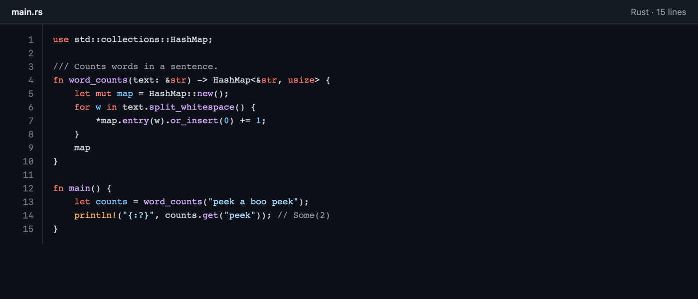
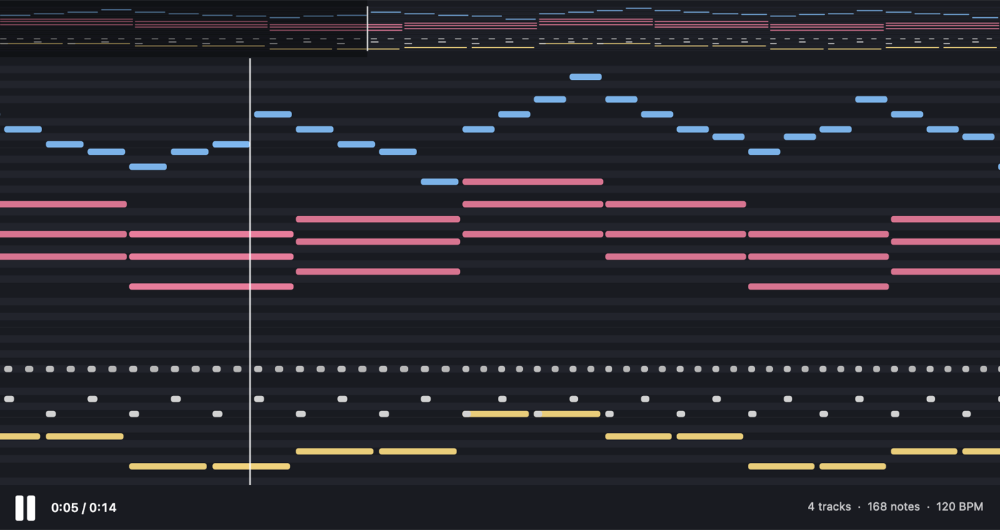

  

<h1 align="center">Peekaboo</h1>

  <b>Press Space on the files macOS can't preview.</b> 
  3D models, Blender files, Lottie animations, Markdown, source code, notebooks, 
  game art, MIDI and tracker music, right in Quick Look.

  <a href="https://github.com/orcamedia/peekaboo-releases/releases/download/updates/Peekaboo.dmg"><b>Download Peekaboo</b></a>
  &nbsp;·&nbsp; free &nbsp;·&nbsp; macOS 14 Sonoma or later &nbsp;·&nbsp; Apple silicon and Intel

---

  

## What it previews

Select a file in Finder and press <kbd>Space</kbd>.

| Files | You see | In Finder |
|---|---|---|
| **glTF / GLB** `.glb` `.gltf` | The 3D model: drag to orbit, scroll to zoom, animations play | Rendered thumbnail |
| **Blender** `.blend` | The preview image Blender saved in the file | Same image |
| **Lottie** `.lottie` | The animation, looping | A frame |
| **Markdown** `.md` | GitHub-style formatting, math, Mermaid diagrams, light or dark | |
| **Source code**, about 60 languages | Syntax highlighting and line numbers | |
| **Jupyter notebooks** `.ipynb` | Rendered cells with their outputs: tables, charts, errors | |
| **Aseprite** `.aseprite` `.ase` | The sprite, animated, with crisp pixels | First frame |
| **Adobe swatches** `.ase` | The colours, with names and hex values | Colour grid |
| **Tiled maps** `.tmx` `.tmj` | The map, zoomable | Map |
| **Krita / Procreate** `.kra` `.procreate` | The artwork, with canvas size and layer count | Artwork |
| **MIDI** `.mid` `.midi` `.kar` | Plays it, with a scrolling piano roll | |
| **Tracker music** `.mod` `.xm` `.it` `.s3m` | Plays it, with the classic pattern view | |
| **SoundFonts** `.sf2` | Its instruments, and a keyboard to play them | |

  

  

## Install

1. [Download Peekaboo.dmg](https://github.com/orcamedia/peekaboo-releases/releases/download/updates/Peekaboo.dmg) and open it.
2. Drag **Peekaboo** to **Applications**.
3. Open Peekaboo once. That switches the previews on; you can close it afterwards.

That's it: press <kbd>Space</kbd> on a supported file in Finder. Peekaboo is signed with a Developer ID and notarized by Apple, so it opens without warnings.

> [!TIP]
> If a preview doesn't appear straight away, open Peekaboo and click **Reset Quick Look**, or log out and back in.

## Tips

- **Music:** MIDI and tracker files start playing when you preview them. <kbd>Return</kbd> pauses and resumes (<kbd>Space</kbd> closes Quick Look). Click the overview strip to jump around. The sound stops as soon as you move to another file.
- **SoundFonts:** pick an instrument, then click the keys or type <kbd>A</kbd> to <kbd>K</kbd> on your keyboard to play it.
- **Images and maps:** pinch or hold <kbd>⌘</kbd> and scroll to zoom.

## Settings

Open Peekaboo to:

- **Switch each type of file on or off.** For Markdown, source code, notebooks and MIDI, switching Peekaboo off gives you back macOS's own preview.
- **Choose whether music plays automatically.**
- **Pick a theme** for Markdown, code and notebooks: automatic, light or dark.
- **Check for updates.** Peekaboo checks once a day in the background and updates itself; you can turn that off.

## Privacy and security

- **Your files stay on your Mac.** Peekaboo has no accounts, analytics or tracking.
- **Every preview runs in Apple's app sandbox.** It can only read the file you're previewing.
- **Previews can't run code from your files.** Scripts embedded in Markdown or notebooks are blocked, and links in previews only open web pages.
- **The only network use:** pictures that a Markdown file or notebook links from the web (like any Markdown viewer), and the daily update check.
- **Updates are signed:** each update must carry Peekaboo's own update signature, or it's refused, and every download is notarized by Apple.

## Good to know

- Peekaboo previews only the file you selected, so it can't load files next to it. Tiled maps are drawn as a colour-coded layout instead of their tile art, and Markdown pictures stored in other files don't show (web pictures do).
- Very large files show a short "too large to preview" note instead, so Quick Look never stalls.
- On Macs with VLC installed, `.mod` files open in Apple's built-in player instead of Peekaboo. `.xm`, `.it` and `.s3m` aren't affected.
- STL, PLY and OBJ models aren't included: macOS previews those itself.

## Uninstall

Open Peekaboo, switch off **Check for updates automatically** (this removes its daily background check), quit it, then drag it from Applications to the Bin. Its previews go with it.

## Problems or ideas?

[Open an issue](https://github.com/orcamedia/peekaboo-releases/issues). Mention your macOS version and, if you can, attach the file that didn't preview (or describe it).

---

Every version is available on the [updates release](https://github.com/orcamedia/peekaboo-releases/releases/tag/updates). `appcast.xml` in this repository is the update feed installed copies check. Peekaboo includes open-source software; see Acknowledgements in the app's Settings.
